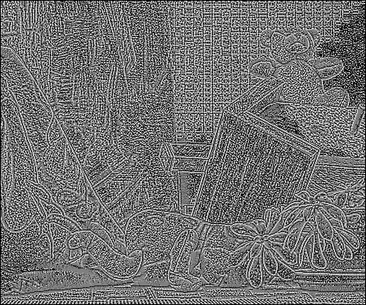
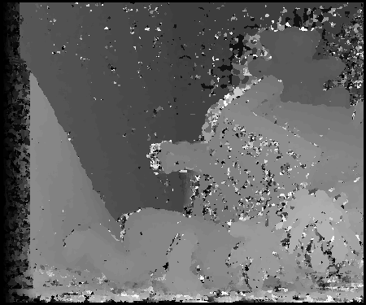
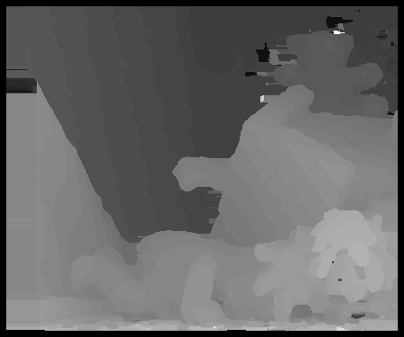
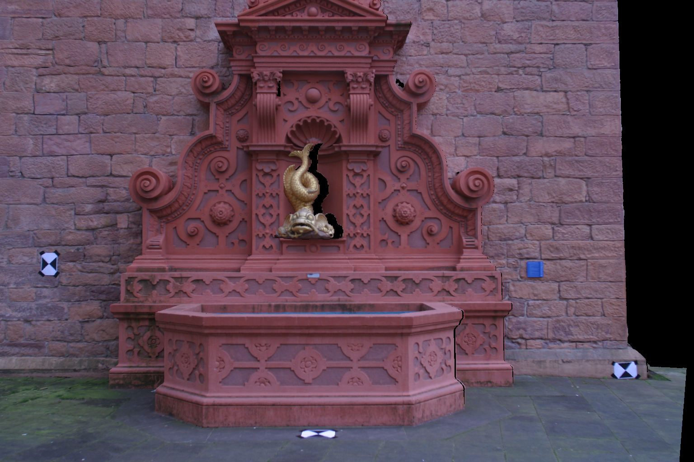
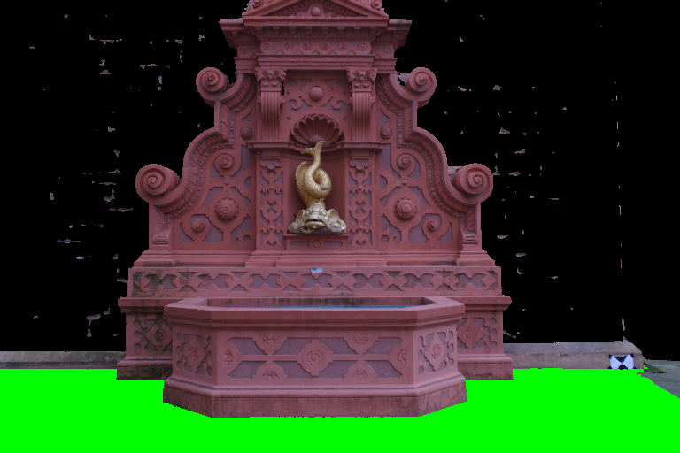
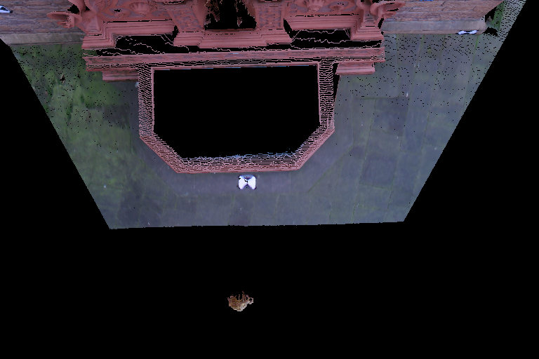
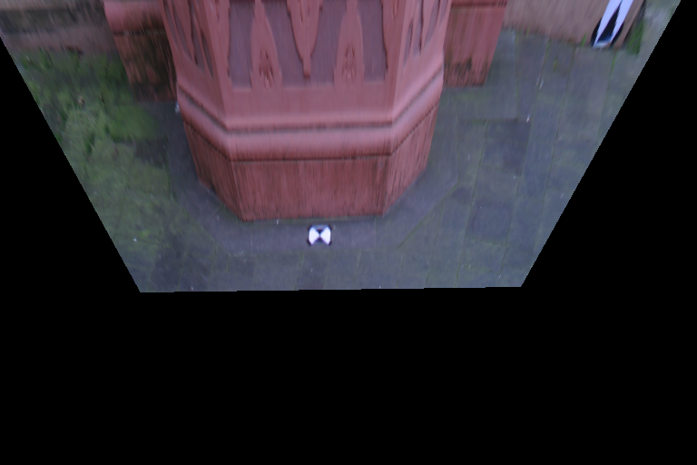

# 3D Computer Vision — Assignment 2

**Main question:** How can I use two views to work out depth, and how do I know
when the result is reliable?

I used the Teddy images to build a stereo matcher, then made a stereo pair from
the fish point cloud from HW1. For the bonus, I found planes with RANSAC and used
the ground plane to make a bird's-eye image warp.

## A. Teddy stereo

**Question:** How well can local brightness patterns find the same point in two images?

**Tool:** Winner-take-all stereo using census descriptors and Hamming distance.
Each pixel tries several horizontal shifts and keeps the one with the lowest cost.

### A1. Build the census descriptor

**Plain English:** Turn the light-and-dark pattern around a pixel into bits.

$$C_I(p)=\mathrm{concat}_{q\in N_c\setminus\{0\}}\mathbf{1}[I(p+q)<I(p)]$$

A darker neighbor gives a 1; otherwise, a 0. The center is left out. A 3 × 3
window gives 8 bits; a 7 × 7 window gives 48. The pattern depends on relative
brightness, though noise and clipping can still change it.

| 3 × 3 census | 7 × 7 census |
| --- | --- |
|  |  |

For these pictures, I counted the 1 bits and scaled the possible range to 0–255.
Matching uses the complete bit pattern, since equal counts can hide different patterns.

### A2. Compare possible matches

**Plain English:** Try a match and count how many bits disagree.

$$H(p,d)=\mathrm{popcount}\left(C_L(x,y)\;\mathrm{XOR}\;C_R(x-d,y)\right)$$

XOR marks differing bits, and popcount counts them. That is Hamming distance.
For Teddy, I searched disparities from 0 through 63.

### A3. Add nearby evidence

**Plain English:** Ask nearby pixels to help score the match.

$$S(p,d)=\sum_{u\in N_A}H(p+u,d)$$

The census window builds the descriptor. The aggregation window adds matching
costs. These are separate window sizes; I tried aggregation sizes 5 × 5 and 9 × 9.

### A4. Pick the winner

**Plain English:** Keep the shift with the fewest disagreements.

$$\hat d(p)=\underset{d\in D}{\arg\min}\;S(p,d)$$

Each pixel chooses independently. Ties use the smaller disparity. Candidates need
complete census and aggregation windows in both views; invalid borders are black.

A **disparity map** stores these horizontal shifts. A point at column 100 on the
left and column 80 on the right has disparity 20 pixels.

| Small windows: census 3, aggregation 5 | Large windows: census 7, aggregation 9 |
| --- | --- |
|  |  |

Larger windows reduced speckle but mixed depths near boundaries. Brighter means
larger disparity. Black can also mean invalid, rather than a distant surface.

### A5. Measure the error and try improvements

I divided the stored ground truth by four and rounded with `floor(value/4 + 0.5)`.
A pixel is bad when its disparity error is **greater than one**.

| Census | Aggregation | Whole-image error | Shared-interior error |
| --- | --- | ---: | ---: |
| 3 | 5 | 27.9911% | 18.8012% |
| 3 | 9 | 24.4480% | 13.1459% |
| 7 | 5 | **24.1807%** | 12.8687% |
| 7 | 9 | 24.5031% | **11.6175%** |

Whole-image error counts all 168,750 pixels, including borders and ground-truth
zeros. Shared-interior error uses the same 131,311 pixels for all settings:
rows `[7,368)`, columns `[70,443)`, stored ground truth >0. The handout doesn't
fully specify this convention, so I kept both scores. They give different winners.

I also tried three changes to the (7,9) baseline:

| Method | Shared-interior error | Whole-image error |
| --- | ---: | ---: |
| Median filter | 11.4453% | 24.3674% |
| Left/right check + filling | **8.6756%** | **20.5055%** |
| Uniqueness check + filling | 10.1568% | 23.3920% |



Checking a match in both directions worked best. I allowed a difference of one
disparity, then filled rejected pixels from trusted neighbors in the same row,
choosing the smaller disparity. Filled pixels still count in the error rate.
It reduced interior bad pixels by about 25.3%, but introduced horizontal streaks.
The other attempts remain commented in `improve_teddy.py`.

## B. Fish stereo

**Question:** Can I set up cameras that produce a matchable stereo pair and explain
the disparities from the scene geometry?

**Tools:** Pinhole projection, rectified cameras, and the same census matcher.

### B1. Rectified images and camera positions

**Rectified images** put corresponding scene points on the same row.

**Plain English:** Look along the same row in the other picture.

$$y_L=y_R,\qquad x_R=x_L-d$$

This makes matching a horizontal search. Rectification doesn't remove occlusions.
I rendered rectified views directly using parallel cameras with the same intrinsics
and a horizontal baseline of 0.12 scene units.

| Left view | Right view |
| --- | --- |
|  |  |

The camera centers are `(0,0,0)` and `(0.12,0,0)`. With
`X_camera = R @ X_world + t`, translation is `t = -R @ C`, so the right camera
uses translation `(-0.12,0,0)`.

### B2. Depth, disparity, and resizing

**Plain English:** A bigger sideways shift means the point is closer.

$$d=\frac{f_x B}{Z},\qquad Z=\frac{f_x B}{d}$$

At `fx=1379.75` pixels, depths 3.8663–9.6567 predict disparities 17.1456–42.8241.
I searched 0–44. Disparity 44 corresponds to depth 3.7630 scene units; zero is the
infinite-depth limit. Physical units are unconfirmed, so lengths use scene units.

I interpreted quarter resolution as quarter total pixels: 3072 × 2048 becomes
1536 × 1024. Scaling the first two rows of K by 0.5 preserves the field of view.
The course still needs to confirm that wording; `fish.py --scale 0.25` supports
the quarter-width/height interpretation instead.


The fish is closer, so it has higher disparity than the wall. I used the required
grayscale weights, `round(0.30R + 0.59G + 0.11B)`, and no maximum filtering or hole filling.

The CPU renderer keeps the nearest positive-depth point per pixel. I used it
because Open3D 0.19.0 headless rendering failed on this Mac. The right-view holes
show surfaces missing from the original single-view cloud.

All four settings ran. Depth-derived diagnostic errors were 0.7700%, 0.2253%,
0.3017%, and 0.2886% for (3,5), (3,9), (7,5), and (7,9). These use 1,379,716
visible interior pixels and a reference from the rendering depth. They aren't
independent ground-truth scores or comparable to Teddy's whole-image errors.

## C. Bonus: RANSAC and homography

**Question:** Can I find the ground, then use that plane to change the viewpoint?
What happens to objects above it?

**Tools:** RANSAC (Random Sample Consensus) finds a plane among outliers. A
plane-induced homography maps that plane between camera views.

### C1. Find and remove planes

**Plain English:** Pick three points, guess a flat surface, and count nearby points.
Repeat and keep the guess with the most support.

$$n^T X+d=0,\qquad \lVert n\rVert=1,\qquad |n^T X+d|<\tau$$

I used three-point SVD fits, threshold `0.025` scene units, seed 532, and 30,000
sampled points for scoring. The trial budget targets 0.999 sampling confidence,
capped at 2,000. I refined the best plane, checked the full remaining cloud,
removed its inliers, and repeated.

| Plane | Inliers | What it found |
| --- | ---: | --- |
| 1 | 2,356,913 | Background wall |
| 2 | 854,217 | Ground |
| 3 | 407,538 | Parts of the fountain facade |



The second plane covers the floor. Its unit normal is approximately
`(0.004634, -0.998713, 0.050514)`, with `d=1.583236` in the original camera frame.
I used its orientation and position to identify it, then checked the green render.
The trial confidence is a sampling heuristic, not proof of correct detection.

### C2. Compare the bird's-eye render and warp

I put the overhead camera 8.9328 scene units above a ground target and pointed
its optical axis along the negative plane normal. Both bonus views are 768 × 512.

**Plain English:** Treat the ground as a flat sheet and move its pixels to the new view.

$$H=K_B\left(R_B-\frac{t_B n^T}{d}\right)K_A^{-1}$$

Here the original camera is the world frame. I inverse-mapped pixels with H and
implemented bilinear interpolation from the four source neighbors directly.

| Direct render from above | Ground-plane warp |
| --- | --- |
|  |  |

The ground follows the mapping, but the raised fountain gets stretched onto the
floor. One homography can't reproduce off-plane parallax. The 3D render keeps
height but exposes missing geometry. Exact plane points agreed under the two
projection calculations within `3.84e-13` pixels; that isn't a whole-image score.

## D. Running it

### D1. Files

There are two folders: `data/` for inputs and `results/` for images, metrics, and PDFs.
Python files are at the root:

| File | Purpose |
| --- | --- |
| `stereo.py` | Census, Hamming distance, aggregation, and winner-take-all |
| `renderer.py` | Point projection, depth buffer, and calibration scaling |
| `planes.py` | Plane fitting, RANSAC, homography, and bilinear warping |
| `teddy.py`, `fish.py`, `bonus.py` | Run each part |
| `improve_teddy.py` | Best refinement, with other attempts commented |
| `check.py` | Small correctness checks |
| `report.py`, `bonus_report.py` | Build the reports |
| `run.py` | Run everything in order |

Inputs are `data/teddyL.pgm`, `data/teddyR.pgm`, `data/disp2.pgm`, and the trusted
HW1 pickle `data/data.obj`. The scene is about 267 MiB and isn't tracked in Git.
Only load the trusted course pickle.

### D2. Commands

Tested with Python 3.12 on Intel macOS. Run from the repository root:

```sh
python3.12 -m venv .venv
.venv/bin/python -m pip install -r requirements.txt
.venv/bin/python -B run.py
```

Individual parts can be run with `teddy.py`, `improve_teddy.py`, `fish.py`, and
`bonus.py`. Results are overwritten when rerun. The reports are
[report.pdf](results/report.pdf) and [bonus.pdf](results/bonus.pdf).
Raw disparity PNGs store pixel shifts; `disparity_view` PNGs are scaled for display.

The checks cover hand-computed descriptors, Hamming counts, direct window sums,
known shifts, brute-force matching, camera geometry, plane fitting, and interpolation.
TODO and JOURNAL track the remaining work and previous sessions. Older journal
paths refer to the layout before cleanup.

### D3. Before submitting

Confirm the Teddy evaluation convention and quarter-resolution wording. Add student
identification if required, check Canvas requirements, and upload the files.
The required experiments and bonus are implemented; nothing has been submitted.

## E. What I learned & most interesting questions

### E1. What I learned

A low matching cost doesn't guarantee a correct match. Checking both directions
helped more than just smoothing. Bigger windows reduced noise but lost detail,
and changing which pixels I counted changed which setting looked best.

The camera setup mattered just as much as matching. Baseline, focal length, and
depth gave me a reason for the search range. The bonus also made the limits clear:
a ground-plane warp can't correctly move a raised object, and neither rendering
nor interpolation can recover geometry that was never captured.

### E2. Questions I'd try next

- **E2a.** Could the window size change near edges instead of staying fixed everywhere?
- **E2b.** When should a rejected match stay unknown rather than be filled?
- **E2c.** How much can I increase the baseline before occlusions outweigh the benefit?
- **E2d.** Would the best Teddy refinement still win on another real image pair?
- **E2e.** Would several plane homographies help the fountain, or would I need fuller 3D data?
