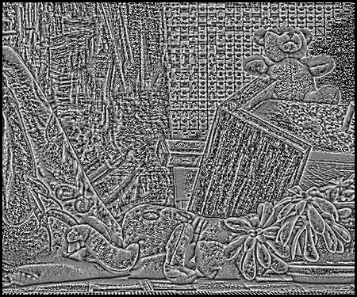
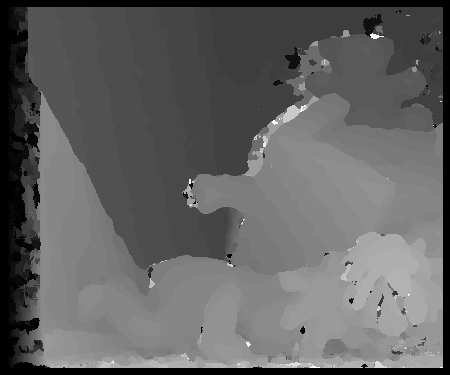
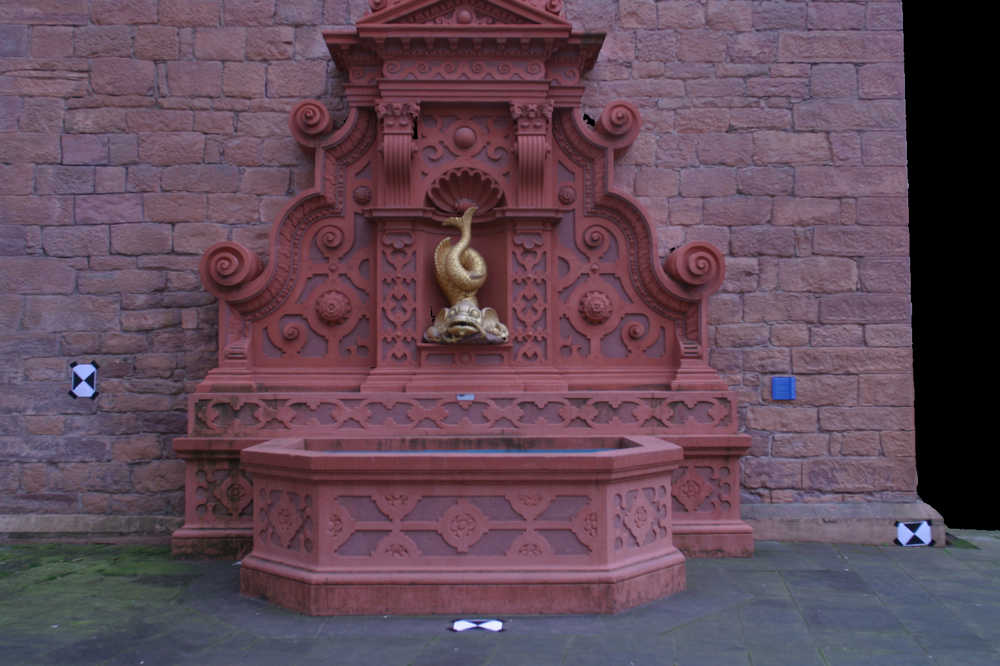
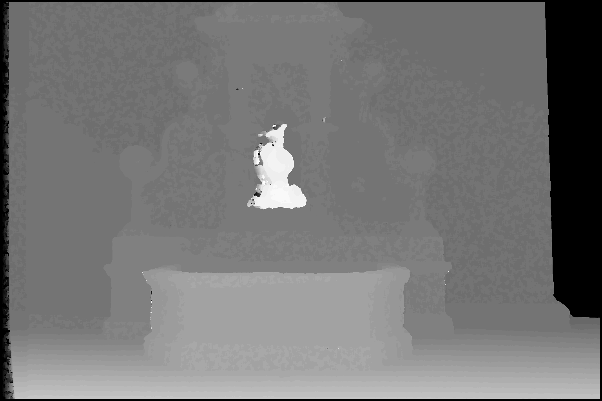

# 3D Computer Vision — Assignment 2

For this assignment, I worked on stereo matching with the Teddy images and then
used the fish point cloud from HW1 to make my own stereo pair. The idea was to
figure out which pixels match between two views and use that shift to estimate depth.

I started with the basic census method, tried different window sizes, and then
tried three things to improve the results. This README goes through what worked,
what didn't, and what I learned from it.

| Part | Starting point | What I worked on |
| --- | --- | --- |
| [A. Teddy stereo](#a-teddy-stereo) | Supplied left/right images and ground truth | Matching, window comparisons, error rates, and refinements |
| [B. Fish stereo](#b-fish-stereo) | HW1 colored point cloud | Camera geometry, rendering a stereo pair, and reusing the matcher |
| [C. Checks, setup, and reflection](#c-checks-setup-and-reflection) | Both experiments | Verification, running the code, and lessons/questions |

## A. Teddy stereo

**Problem 1 starts with two supplied photographs.** Here I built the census
matcher, compared window sizes, measured error against the supplied ground truth,
and tried three improvements. Everything in sections 1–4 uses the Teddy pair.

### 1. How the census transform works

#### 1a. Building the descriptor

The census transform compares each pixel with the pixels around it. If a neighbor
is darker than the center, it records a 1; otherwise, a 0. A 3 × 3 window gives
eight bits, and a 7 × 7 window gives 48. Hamming distance just counts how many
bits are different between two descriptors.

What I took from this is that the actual brightness doesn't have to match exactly.
The ordering of darker and lighter pixels matters. That helps with brightness
changes that preserve the ordering, although noise and clipping can still cause problems.

#### 1b. Seeing what it records

| 3 × 3 census | 7 × 7 census |
| --- | --- |
|  |  |

To display the descriptors, I counted the 1 bits and scaled the possible range
to 0–255. Both images pick up similar edges, but the larger window picks up more
of the surrounding structure. The matching code still uses all the bits. Just
counting the 1s would lose their positions and could make different patterns look the same.

### 2. What happened when I changed the window sizes

#### 2a. Finding a match

For every pixel in the left image, I searched for a match in the right image
using `x_right = x_left - d`, with disparities from 0 to 63. I added up the
Hamming distances over a window and picked the disparity with the lowest cost.
That's the winner-take-all part. If costs tie, the smaller disparity wins.
I used integral images to calculate the window sums faster.

#### 2b. Comparing small and large windows

| Census 3 × 3, aggregation 5 × 5 | Census 7 × 7, aggregation 9 × 9 |
| --- | --- |
|  |  |

Brighter pixels indicate larger disparity and therefore closer surfaces. Display
values map disparities 0–63 to 0–255. Black can mean either zero disparity or an
invalid pixel; the separate validity masks distinguish them.

The larger windows made the result less noisy. They didn't fix everything,
though. Around an object's edge, one window can contain both the object and the
background, so it mixes information from different depths. Thin objects are
also harder to keep. I only allowed matches where both windows fit in both images.

### 3. A lower error number needs some context

#### 3a. Calculating the error

Ground truth is divided by four and rounded with `floor(value / 4 + 0.5)`.
A pixel is bad when its disparity differs by **more than one** from that result.
An error of exactly one is acceptable.

| Census size | Aggregation size | Whole-image error | Shared-interior error |
| --- | --- | ---: | ---: |
| 3 | 5 | 27.9911% | 18.8012% |
| 3 | 9 | 24.4480% | 13.1459% |
| 7 | 5 | **24.1807%** | 12.8687% |
| 7 | 9 | 24.5031% | **11.6175%** |

#### 3b. Checking which pixels count

The whole-image metric counts all **168,750 pixels**, including black output
borders and ground-truth zeros. The shared-interior metric uses the same
**131,311 pixels** for every configuration: rows `[7,368)`, columns `[70,443)`,
and stored ground truth greater than zero. These pixels support every searched
disparity under all four window settings.

This was something I had to be careful about: 11.62% looks much better than
24.50%, but they count different pixels. Larger windows also leave bigger invalid
borders, which affects the whole-image score. Even the best window setting changes
depending on which score I use.

So I kept both results and made the pixel counts clear. I still need to confirm
how the course wants borders and ground-truth zeros handled. Excluding those zeros
is an assumption in the masked score.
[Detailed results and all three metric variants](results/teddy.md).

### 4. I tried three things to make it better

#### 4a. Comparing the three attempts

Starting with the 7 × 7 census and 9 × 9 aggregation result, I tried a median
filter, a left/right check, and a uniqueness check. Each was tested separately
against the same baseline.

| Method | Shared-interior error | Whole-image error |
| --- | ---: | ---: |
| Baseline | 11.6175% | 24.5031% |
| Median filter | 11.4453% | 24.3674% |
| Left/right check + filling | **8.6756%** | **20.5055%** |
| Uniqueness check + filling | 10.1568% | 23.3920% |

#### 4b. Keeping the best result

| Baseline | Left/right check + filling |
| --- | --- |
|  |  |

The left/right check worked best. Basically, if a pixel matches somewhere in the
right image, matching back should bring it to roughly the same place. I allowed
a difference of one disparity. For rejected matches, I filled from the nearest
trusted pixels in the same row, choosing the smaller disparity.

The filled pixels still count in the error rate. I didn't get a better score by
leaving the difficult pixels out. This gave about 25.3% fewer bad interior pixels.

#### 4c. What still goes wrong

You can see the improvement, but also some horizontal streaks from filling.
It can lose thin foreground details too. The median filter barely helped compared
with the left/right check. I learned that a cleaner image and a lower error rate
are both useful to check. These results are just for Teddy; I haven't tested the
improvements on another scene.

Only the best refinement runs in the experimental script. The other attempts remain
as commented code. The required unfiltered results are preserved separately.
[Experiment details](results/teddy_improvements.md).

## B. Fish stereo

**Problem 2 starts with the 3D point cloud from HW1.** Here I had to create the
left and right images first, which meant choosing the camera positions,
calibration, resolution, and disparity range. Then I reused the Teddy matcher.
Sections 5–6 cover that setup and the fish results.

### 5. Making a stereo pair from the fish scene

#### 5a. Setting up the cameras

For the fish scene, I used parallel cameras with the same calibration and a
horizontal separation of **0.12 scene units**. The left camera center is at the
origin; the right center is `(0.12, 0, 0)`.

| Left view | Right view |
| --- | --- |
|  |  |

One detail I checked was the camera translation sign. The camera position and
the translation in the matrix aren't the same thing. With
`X_camera = R @ X_world + t`, the translation is `t = -R @ C`.
So putting the right camera at positive X means using a negative X translation.
Both cameras keep the same orientation, and matching points project to the same row.

#### 5b. Choosing the disparity range

The depth–disparity relationship is:

```text
d = fx × baseline / Z
```

At the chosen resolution, `fx = 1379.75` pixels. Scene depths of approximately
3.8663–9.6567 predict disparities of 17.1456–42.8241 pixels. I therefore searched
**0–44**, allowing a small rounding margin. Disparity 44 corresponds to depth
3.7630 scene units; disparity zero is the infinite-depth limit. Baseline and
scene depth must use the same units, but a physical metre scale is not required.

#### 5c. Checking the result



This is the result with a 3 × 3 census window and 9 × 9 aggregation window,
displayed over disparities 0–44. The fish is brighter because it's closer.
The wall is farther away, so its disparity is smaller.

All four window settings were run. Against a depth-derived reference, their
masked diagnostic errors were 0.7700%, 0.2253%, 0.3017%, and 0.2886% for
`(3,5)`, `(3,9)`, `(7,5)`, and `(7,9)`. These are **synthetic consistency checks**,
not independent ground-truth scores: the reference comes from the rendering depth,
and the mask excludes holes and many occlusions. They are not comparable to
Teddy's whole-image errors. [Fish geometry and results](results/fish.md).

### 6. What I had to sort out with rendering

#### 6a. Resizing without changing the view

I interpreted “quarter resolution” as one quarter of the total pixel count:
3072 × 2048 becomes **1536 × 1024**. Scaling the first two rows of the intrinsic
matrix by 0.5 scales focal lengths and principal point with the image dimensions,
preserving horizontal and vertical field of view. The alternate interpretation,
quarter width and height, is available through `--scale 0.25`; course confirmation
of the wording is still pending.

#### 6b. Getting the renderer working on my Mac

Open3D 0.19.0 offscreen rendering failed on this Intel Mac with
`EGL Headless is not supported on this platform`, even outside the sandbox.
I adapted HW1's NumPy projection approach instead. The CPU renderer keeps the
nearest positive-depth point at each rounded pixel using a depth buffer. It uses
zero-based pixels and does not apply maximum filtering, interpolation, or hole filling.

#### 6c. Understanding the missing parts

The holes beside the fish in the right image aren't just noise. Moving the camera
reveals areas the original point cloud doesn't contain. Projecting the points
again can't create those missing surfaces, so I left the holes black.
For grayscale, I used the assignment's weights:
`round(0.30 R + 0.59 G + 0.11 B)`.

## C. Checks, setup, and reflection

The rest covers checks for both problems, how to run the code, what is left,
and what I learned from the assignment.

### 7. How I checked it

I checked small examples before relying on the full images:

- **7a.** A hand-computed census descriptor and Hamming counts spanning all 48 bits.
- **7b.** Integral window sums compared with direct neighborhood sums.
- **7c.** Identical inputs giving zero disparity and controlled shifts recovering the known shift.
- **7d.** Winner-take-all results compared with an independent nested-loop reference.
- **7e.** Border masks, tie behavior, and the bad-pixel threshold.
- **7f.** Camera projection, rectification, calibration scaling, grayscale weights, and RGB file readback.
- **7g.** Refinement filling rules and reverse matching on a known shifted image.

These checks passed. I also checked the rendered report pages and 36 output
images for things like dimensions, mask values, and disparity ranges. The
remaining questions are about the assignment's conventions, especially the
resolution wording and which pixels to count in the Teddy error rate.


### 8. Running it

#### 8a. Environment

The tested setup is **Python 3.12 on Intel macOS**. From the repository root:

```sh
python3.12 -m venv .venv
.venv/bin/python -m pip install -r requirements.txt
.venv/bin/python -m pip check
```

#### 8b. Inputs

The dependency file records the installed versions; other platforms may require
compatible package adjustments. Restore these inputs before running:

| Input | Purpose |
| --- | --- |
| `teddy/teddyL.pgm`, `teddy/teddyR.pgm` | 450 × 375 grayscale stereo pair; also supplied in `teddy 2.zip` |
| `teddy/disp2.pgm` | Stored ground-truth disparity |
| `data/data.obj` | Trusted HW1 pickle: image dimensions, window settings, K, foreground and background XYZ/RGB arrays |

The fish data is approximately 267 MiB and is excluded from Git. Obtain it from
the HW1 course materials and place it at `data/data.obj`. Load only the trusted
course pickle. Physical units are unconfirmed; all camera translations and depths
use the cloud's scene units.

#### 8c. Commands

```sh
# Validate inputs and the CPU renderer.
.venv/bin/python scripts/check_inputs.py
.venv/bin/python scripts/check_renderer.py

# Check and run the required Teddy method.
.venv/bin/python scripts/check_stereo.py
.venv/bin/python scripts/run_teddy.py

# Run the selected optional Teddy refinement.
.venv/bin/python scripts/try_teddy_improvements.py

# Check and run the rendered fish stereo experiment.
.venv/bin/python scripts/check_fish_geometry.py
.venv/bin/python scripts/run_fish.py

# Build the five-page report from the saved results.
.venv/bin/python scripts/build_report.py
```

#### 8d. Where the files go

| Location | Contents |
| --- | --- |
| [src/stereo.py](src/stereo.py) | Census descriptors, Hamming costs, aggregation, and matching |
| [src/pointcloud_renderer.py](src/pointcloud_renderer.py) | CPU projection, visibility, and intrinsic scaling |
| `output/teddy/` | Required census images, disparity maps, masks, and measurements |
| `output/teddy_improvements/` | Refinement images, original comparison, and `best_metrics.json` |
| `output/fish/scale_0.5_baseline_0.12/` | Fish views, disparities, depths, masks, and geometry measurements |
| `output/pdf/homework2_report.pdf` | One explanatory page followed by four figure pages |
| [docs/images/](docs/images/) | Selected output snapshots embedded in this README |

`output/` is generated locally and ignored by Git. The embedded snapshots are
stored separately so the README remains readable in a fresh checkout. Rerunning
the experiments does not automatically refresh these snapshots.

The original `dolly_zoom_fast-1.py` and Open3D diagnostic remain for reference;
they are not required by the working CPU pipeline. The original dolly-zoom
sequence has not been validated.

### 9. What is left

#### 9a. Before submitting

The main experiments and report are done. Before submitting, I still need to
confirm the Teddy evaluation rules and what “quarter resolution” means, review
the report, add my details if needed, and package the files. Nothing has been
uploaded to Canvas. I haven't done the optional plane estimation and homography bonus.

#### 9b. Notes and assignment files

See [TODO.md](TODO.md) for the checklist, [JOURNAL.md](JOURNAL.md) for session-by-session
attempts and outcomes, and the supplied `cs532f27_hw2 (1).pdf` and
`HW2Bonus-1 (1).pdf` for the assignment requirements.

### 10. What I learned & most interesting questions

#### 10a. Teddy: what actually makes a match useful?

The biggest thing I learned is that finding a low matching cost doesn't mean the
match is right. Repeated textures can give a convincing match in the wrong place.
The left/right check helped because it asked whether the match made sense from
both directions. That worked better here than just smoothing the result.

#### 10b. Teddy: a better-looking image isn't the whole answer

The larger windows and filling made things look cleaner, but they also lost some
detail. I need to look at the image and the numbers together. Even then, I have
to check what those numbers count. The 11.62% and 24.50% scores came from the
same prediction with different evaluation masks.

#### 10c. Fish: the camera setup is part of the algorithm

I learned how the baseline, focal length, and depth fit together. Once those are
set, the disparity range has a reason behind it. I also had to keep track of the
camera position versus its matrix translation, and scale the intrinsics along
with the image. Those details decide whether the later matching even makes sense.

#### 10d. Fish: some missing pixels are actually missing information

The holes in the fish scene made this clearer for me. Moving the camera can show
an area that wasn't in the original point cloud. Filling that hole might make
the image look complete, but it doesn't mean I recovered the actual surface.

#### 10e. Could the window size change depending on the pixel?

The bigger windows helped broad regions but caused trouble at edges. Could I use
a bigger window where the surface is fairly consistent and a smaller one near
boundaries? I'd want to test whether that keeps the lower noise without losing
as much detail.

#### 10f. When should I fill a rejected match, and when should I leave it unknown?

Filling improved the score, but the horizontal streaks show where the assumption
can go wrong. I'd like to compare the current row-based filling with a method
that uses image edges, and also show which values were measured and which were filled.

#### 10g. How far apart should the cameras be?

A larger baseline gives a larger disparity, but it also changes how much of the
scene both cameras can see. Where does that stop helping? I'd try several
baselines on the same scene and compare errors, visible coverage, and holes.

#### 10h. Would the best method still win on another pair?

The left/right check worked best on Teddy, while the rendered fish pair was much
easier to match on its visible surfaces. I'd want to try another real stereo pair
before assuming the same settings are generally better. The next comparison
should keep the evaluation rules fixed from the start.
